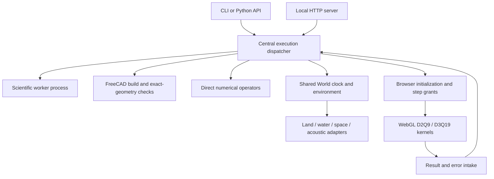

# Architecture

The installable `engineering_sim` package separates execution control from numerical methods. `execution.py` owns callback registration, context-local execution records, operation revision identity, state transitions and browser work grants. Scientific calls are static or transient operations, not forcibly advanced by the particle world's timestep.

`core/` contains Warp particle/rigid/beam/contact kernels, atmosphere, wind, terrain and state logging. Domain adapters retain domain state and force models. `science/` contains the chemistry, thermodynamics, biochemistry, chemical engineering, quantum/MD, materials and mechanics implementations. `fea.py` supplies general elasticity and 2D/3D magnetostatic weak operators for caller meshes and fields. Design-specific finite-element models require their own mesh-convergence and physical validation.

`flow/` provides a portable SU2 case adapter, horseshoe-vortex kernel, lattice configuration and stability derivatives. SU2 is an external executable, not bundled. `web/` contains real population-field solvers and a small synthetic UI. `cad/` contains exact import/rebuild and generic features. `checks/`, `structures.py`, `thermal.py`, `cooling.py`, `grilles.py` and `molding_process.py` expose reusable dimensional and physical checks with caller-supplied inputs.

The loopback web server validates Host/Origin and serves only its static assets plus the browser-control endpoint. It is a local demonstration server, without multi-user authentication or a production deployment claim. Optional chemistry lookups use public providers only when requested by the relevant operation; offline inputs remain available.
